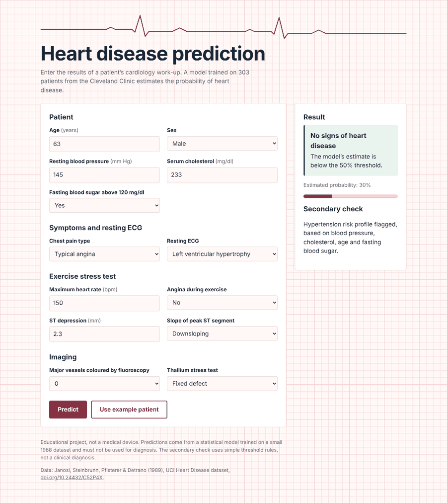
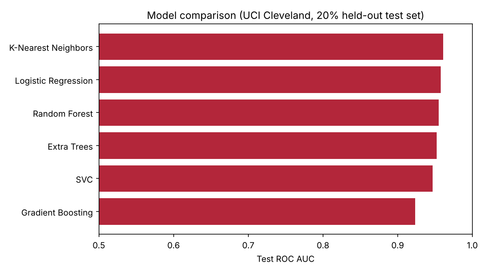
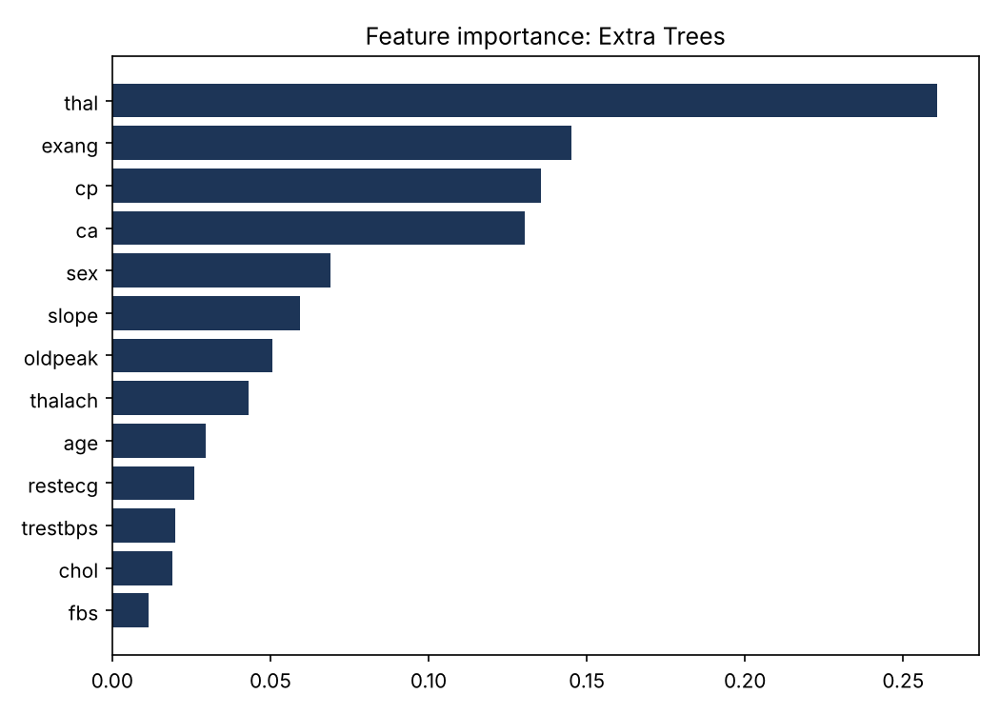

# Heart Disease Prediction

Predicts the probability of heart disease from 13 clinical measurements and serves the model through a Flask web app. Built at Deggendorf Institute of Technology under the guidance of Prof. Ginu Alunkal.

**Live demo:** https://heart-disease-prediction-w8ez.onrender.com (free hosting: the first load can take up to a minute while the server wakes up)



## What it does

- Compares six classifiers (Logistic Regression, Random Forest, Gradient Boosting, SVC, K-Nearest Neighbors, Extra Trees) with `GridSearchCV` and 5-fold stratified cross-validation, and picks the best one by cross-validated ROC AUC.
- Keeps imputation and scaling inside scikit-learn pipelines, so no information from the test set leaks into training.
- Runs a two-stage check: if no heart disease is predicted, a secondary model flags hypertension or diabetes risk profiles.
- Provides a web form for entering patient values and getting a prediction, with input validation and an example patient.
- Includes an optional dense neural network (Keras), from the original version of the project.

## Results

UCI Cleveland dataset, 303 patients, 20% stratified held-out test set (61 patients). Models were selected on cross-validation, so the test scores are not tuned to the test set.

| Model | CV ROC AUC | Test ROC AUC | Test accuracy | Recall | Specificity |
|---|---|---|---|---|---|
| **Extra Trees (deployed)** | **0.902** | 0.952 | 0.836 | 0.857 | 0.818 |
| Logistic Regression | 0.900 | 0.958 | 0.852 | 0.893 | 0.818 |
| K-Nearest Neighbors | 0.898 | 0.961 | 0.885 | 0.964 | 0.818 |
| SVC | 0.898 | 0.947 | 0.836 | 0.893 | 0.788 |
| Random Forest | 0.884 | 0.955 | 0.902 | 0.964 | 0.848 |
| Gradient Boosting | 0.881 | 0.923 | 0.852 | 0.857 | 0.848 |

The models are close: the differences are within what you'd expect from a 61-patient test set. A simple logistic regression does almost as well as the ensembles on this data.

<p>
  
  
</p>

### About the secondary check

The dataset has no hypertension or diabetes diagnoses, so these labels are generated with threshold rules (hypertension: age > 50, cholesterol > 200 and resting BP > 140; diabetes: fasting blood sugar > 120 mg/dl and cholesterol > 200). A decision tree learns these rules with 98.7% accuracy. This shows the two-stage pipeline working; it is not clinical prediction.

### Lessons from the first version

The first version of this project used a 1,889-row copy of the dataset and reported 96.8% accuracy and ROC AUC 0.997. That copy appears to contain the same patients many times over, so identical records can land in both the training and test sets, which inflates the scores. This version uses the original 303 patients with no duplicates, and the scores above reflect that.

## Run it locally

```bash
git clone https://github.com/akhileshsuresh97/heart-disease-prediction.git
cd heart-disease-prediction
python -m venv .venv
source .venv/bin/activate        # Windows: .venv\Scripts\activate
pip install -r requirements.txt
python app.py
```

Open http://localhost:5000 and select **Use example patient**, then **Predict**.

### Retrain the models

```bash
pip install -r requirements-train.txt
python src/train.py              # saves models/ and figures/
```

The optional neural network needs TensorFlow: `pip install tensorflow`, then `python src/train_nn.py`.

## Project structure

```
app.py                  Flask app
templates/index.html    Web form and results
src/train.py            Model comparison, evaluation, secondary model
src/train_nn.py         Optional Keras neural network
models/                 Trained models and metrics.json
figures/                Plots generated by train.py
data/                   UCI Cleveland dataset
render.yaml             Deployment config for Render
```

## Tech

Python, scikit-learn, pandas, Flask, gunicorn, matplotlib, TensorFlow/Keras (optional)

## My role

I built the full pipeline: data preprocessing and EDA, model training and tuning, the neural networks, the two-stage prediction flow, and the Flask deployment. The accompanying report was co-authored with A. Madhu and N. C. Nandan.

## Data

Janosi, A., Steinbrunn, W., Pfisterer, M., & Detrano, R. (1989). Heart Disease [Dataset]. UCI Machine Learning Repository. https://doi.org/10.24432/C52P4X (CC BY 4.0)

## Disclaimer

Educational project, not a medical device. Do not use it for diagnosis.
